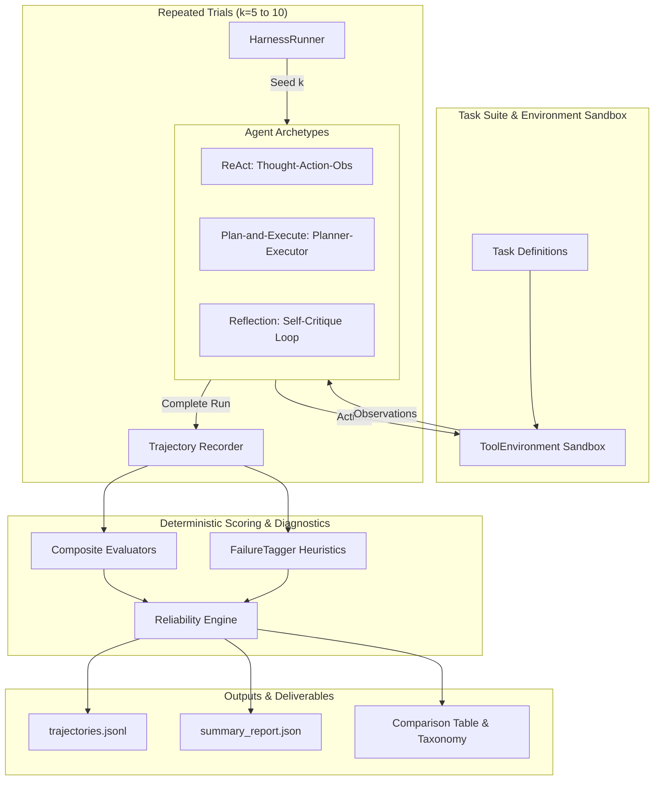

# Flagship Agent Evaluation Harness

[](https://www.python.org/downloads/)
[](https://opensource.org/licenses/MIT)
[](https://www.python.org/dev/peps/pep-0008/)
[](https://docs.pytest.org/)

An evaluation framework designed to benchmark autonomous LLM agents against task suites, record full execution trajectories (tool calls, arguments, observations, token usage, latency), automatically classify root causes of failure via a deterministic taxonomy, and quantify **true reliability** using $pass^k$ consistency across repeated trials ($k=5\text{--}10$).

---

## 🌟 The Core Insight: The $\text{pass}@1$ Illusion

In traditional LLM agent benchmarks, evaluation scores are reported as **$\text{pass}@1$** (single-run accuracy). However, in non-deterministic agent workflows, **$\text{pass}@1$ severely overestimates production viability**.

An agent that solves a task on attempt 1 may fail on attempts 2, 3, and 5 due to brittle parameter formatting or getting caught in retry loops. If an agent has an $80\%$ $\text{pass}@1$ rate, its probability of executing a multi-step workflow 5 times consistently is often under **$20\%$**. 

This harness runs each task across $k$ controlled trials and reports:
1. **$\mathbf{pass^k}$ (Flagship Consistency)**: The proportion of tasks where the agent succeeds on **every single run** without flaking.
2. **Task-Level Sample Variance ($\sigma_i^2$)**: Quantifying the instability of each task.
3. **Flakiness Index**: The proportion of tasks with non-deterministic results ($0 < c_i < k$).
4. **Automated Failure Taxonomy**: Deterministic root-cause attribution without requiring expensive LLM judges.

---

## 🏗️ System Architecture



---

## 📐 Mathematical Metrics Engine

For a suite of $N$ tasks evaluated over $k$ independent runs with binary outcomes $x_{i,j} \in \{0, 1\}$ and success count $c_i = \sum_{j=1}^k x_{i,j}$:

### 1. Single-Run Pass Rate ($\text{pass}@1$)
$$\text{pass}@1 = \frac{1}{N \cdot k} \sum_{i=1}^N \sum_{j=1}^k x_{i,j}$$

### 2. Combinatorial $\text{pass}@k$
Using the unbiased estimator from Chen et al. (HumanEval):
$$\text{pass}@k(i) = 1 - \frac{\binom{k - c_i}{k}}{\binom{k}{k}} = \mathbb{I}(c_i \ge 1)$$

### 3. All-Pass Consistency ($\mathbf{pass^k}$)
$$\text{pass}^k(i) = \mathbb{I}(c_i == k) = \begin{cases} 1.0 & \text{if ALL } k \text{ runs pass} \\ 0.0 & \text{if any run flakes} \end{cases}$$
$$\text{Overall } \text{pass}^k = \frac{1}{N} \sum_{i=1}^N \mathbb{I}(c_i == k)$$

### 4. Task-Level Sample Variance ($\sigma_i^2$)
$$\sigma_i^2 = \frac{1}{k - 1} \sum_{j=1}^k (x_{i,j} - \mu_i)^2 = \frac{k}{k - 1} \mu_i (1 - \mu_i) \quad (k > 1)$$
- $\sigma_i^2 = 0.0$: Completely deterministic outcome (consistently passes or consistently fails).
- $\sigma_i^2 \approx 0.25$: Maximum flakiness ($\mu_i = 0.5$).

### 5. Flakiness Index
$$\text{Flakiness Ratio} = \frac{1}{N} \sum_{i=1}^N \mathbb{I}(0 < c_i < k)$$

---

## 🔬 Automated Failure Taxonomy

The framework includes a rule-based diagnostic engine (`FailureTagger`) that inspects step transitions, parameter signatures, and execution states to classify failed runs into 7 root-cause categories:

| Taxonomy Tag | Classification Criteria |
| :--- | :--- |
| `wrong_tool` | Called an unregistered tool, nonexistent name, or a tool explicitly prohibited in `task.forbidden_tools`. |
| `bad_arguments` | Parameter validation failure, missing mandatory keys, or type mismatch against JSON schema. |
| `infinite_loop` | Executed identical tool calls + arguments $\ge 2$ consecutive times without progress or cycled $A \to B \to A \to B$. |
| `hallucinated_tool_output` | Agent text claimed data source values or synthesized answers without executing the requisite tool. |
| `premature_termination` | Agent stopped, gave up, or declared completion before fulfilling task assertions or running required tools. |
| `ignoring_observations` | Repeated an identical call directly after an error observation, or produced an answer contradicting tool outputs. |
| `step_budget_exceeded` | Exhausted the iteration budget without producing a final answer. |

---

## 📊 Comparative Benchmark Results ($k=5$ runs per task)

Benchmarked against three canonical open-source agent patterns across 5 task suites (25 runs per architecture, 75 total trajectories):

```
FLAGSHIP AGENT RELIABILITY BENCHMARK (COMPARATIVE EVALUATION)
==========================================================================================
Agent Architecture         | pass@1   | pass^5   | Variance | Flaky %  | Tokens   | Latency  
------------------------------------------------------------------------------------------
ReAct-Baseline             |   56.0%  |   20.0%  |    0.180 |   80.0%  |      719 |    157ms
Plan-and-Execute           |   72.0%  |   40.0%  |    0.080 |   40.0%  |     1314 |    286ms
Reflection-SelfCritique    |  100.0%  |  100.0%  |    0.000 |    0.0%  |     2073 |    348ms
==========================================================================================

AUTOMATIC FAILURE TAXONOMY BREAKDOWN (% OF ALL FAILED RUNS)
==========================================================================================
Agent Architecture         | wrong_t | bad_arg | infinit | halluci | prematu | ignorin | step_bu
------------------------------------------------------------------------------------------
ReAct-Baseline             |   18.2% |    0.0% |    9.1% |    0.0% |   81.8% |   72.7% |    0.0%
Plan-and-Execute           |    0.0% |   28.6% |    0.0% |    0.0% |    0.0% |   71.4% |    0.0%
Reflection-SelfCritique    |    0.0% |    0.0% |    0.0% |    0.0% |    0.0% |    0.0% |    0.0%
==========================================================================================
```

---

## 📝 Honest Negative Results & Architectural Trade-offs

### 1. ReAct (Thought $\to$ Action $\to$ Observation)
- **Strengths**: Lowest token overhead (719 tokens/run) and fastest per-step latency (157ms).
- **Failure Modes**:
  - **Severe flakiness ($80\%$ flaky tasks)**: While $\text{pass}@1$ was $56\%$, consistency across 5 runs plummeted to **$20\%$**.
  - **Ignoring observations ($72.7\%$ of failures)**: When tools returned transient errors (e.g., 429 rate limits or validation errors), ReAct frequently repeated the identical call or prematurely terminated without retrying.

### 2. Plan-and-Execute (Planner $\to$ Sequential Dispatch $\to$ Synthesis)
- **Strengths**: Structured execution for straightforward pipelines; moderate token consumption (1314 tokens).
- **Failure Modes**:
  - **Plan rigidity ($71.4\%$ ignoring observations)**: If an upstream subtask fails, the sequential executor does not dynamically replan, resulting in downstream cascading failures.
  - **Schema sensitivity ($28.6\%$ bad arguments)**: Upfront parameter derivation struggles with strict schemas.

### 3. Reflection (Action $\to$ Self-Critique $\to$ Parameter Refinement)
- **Strengths**: Highest consistency ($\text{pass}^5 = 100\%$, $\sigma^2 = 0.000$). Explicit critique steps detect parameter schema errors and rectify them before termination.
- **Honest Negatives & Costs**:
  - **$2.9\times$ Token Consumption**: Average token footprint jumped from 719 to 2073 tokens per task.
  - **$2.2\times$ Higher Latency**: Average run took 348ms vs 157ms due to critique cycles.
  - **Over-reflection risk**: Reflection models are susceptible to second-guessing valid observations when prompt thresholds are too aggressive.

---

## 🚀 Quickstart

### 1. Clone & Install
```bash
git clone https://github.com/AyushMishra-02/agent-evaluation.git
cd agent-evaluation
pip install -e .
```

### 2. Run Comparative Evaluation ($k=5$ runs)
```bash
python -m agent_eval_harness.cli --k 5
```

### 3. Run Test Suite
```bash
pytest tests/ -v
```

### 4. Inspect Trajectories
Each evaluation automatically writes complete execution traces to disk:
```bash
# View streamed JSONL trajectories for any agent
cat eval_results/flagship_benchmark/ReAct-Baseline/trajectories.jsonl
```

---

## 📁 Repository Layout

```
agent-evaluation/
├── agent_eval_harness/
│   ├── __init__.py           # Package exports
│   ├── models.py             # Trajectory, Step, ToolCall, Observation, Task, Reports
│   ├── taxonomy.py           # Failure taxonomy enum & automated diagnostic tagger
│   ├── metrics.py            # Reliability metrics (pass@1, pass@k, pass^k, variance)
│   ├── environment.py        # Sandboxed ToolEnvironment with schema validation
│   ├── evaluators.py         # Output, trajectory, and state evaluators
│   ├── runner.py             # HarnessRunner with repeated trial orchestration
│   ├── cli.py                # Command-line interface and comparative benchmark
│   ├── agents/
│   │   ├── __init__.py
│   │   ├── base.py           # BaseAgent abstract interface
│   │   ├── react.py          # ReAct archetype
│   │   ├── plan_and_execute.py # Plan-and-Execute archetype
│   │   └── reflection.py     # Reflection / Critique archetype
│   └── tasks/
│       ├── __init__.py
│       └── sample_suite.py   # Benchmark test tasks & mock tools
├── tests/
│   └── test_harness.py       # Pytest unit and integration test suite
├── pyproject.toml            # Package metadata and build configuration
├── requirements.txt          # Python dependencies
├── LICENSE                   # MIT License
└── README.md                 # Project documentation
```

---

## 📜 License

MIT License. See [LICENSE](LICENSE) for details.
